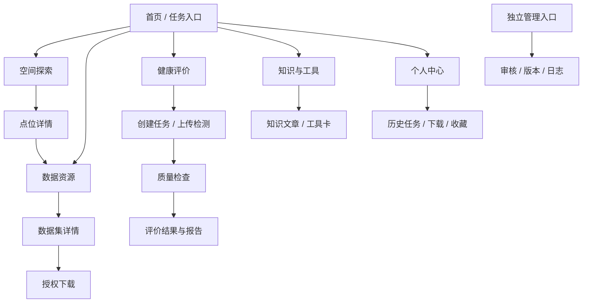

# 壤脉天玑网站设计方案

版本：草案 1.0｜日期：2026-10-31｜对应需求：`01-现状评估与需求档案.md`

## 1. 设计目标

网站服务三条主路径：**看空间数据 → 找并获取可信数据 → 提交自己的检测数据获得可追溯评价**。知识库随时提供解释，个人中心保存用户自己的任务和下载记录。首页让用户选任务；地图保留大画布；数据库以数据集为单位而非 SQL 表为单位；评价以逐步检查为主。

设计语气沿用现有“壤脉天玑”的克制绿色和研究工具感，保留 Leaflet 地图、图层抽屉、右侧点位详情的有效结构。页面优先中文，英文仅用于必要的标准名或代码。现有 CSS 的多套根变量需收束为一组语义令牌，具体色值以视觉核对后的现有品牌色为起点，而非另造一套品牌。

## 2. 信息架构



主导航建议固定为“空间探索、数据资源、健康评价、知识与工具”，右侧为个人中心；“Gold Dataset”“证据追溯”等研究词汇放到对应数据集或报告的详情页。研究演示入口仍可保留在开发/科研区域，清楚标注状态。

## 3. 页面设计

### 3.1 首页

- 首屏一句话说明平台用途，下方给出四个任务入口；避免把指标数或格点数当作科学成果。
- 最近任务只对登录用户显示；公开区展示可用数据集、更新记录和知识文章。
- 每张入口卡写明下一步动作，例如“选指标看地图”“筛选并申请数据”“上传检测数据”。

### 3.2 空间探索

桌面布局：顶部导航与数据状态；左侧按分类/关键词筛图层；中央地图；右侧点位详情。地图点位详情首屏只展示位置、数据类型、六项核心值和“是否有可发布评价”；其他指标折叠。

```text
┌──────────────────── 导航 / 数据版本 / 账号 ────────────────────┐
│ 图层目录  │                  地图与图例                  │ 点位详情 │
│ 分类搜索  │  正式/预览图层状态、透明度、分辨率、参考分区  │ 来源类型 │
│ 图层卡片  │  点击位置或已审核采样点                        │ 核心指标 │
│          │                                                │ 评价状态 │
└──────────┴────────────────────────────────────────────────┴──────────┘
```

- “实测样本点”与“网格值查询”使用不同标记和标题；没有样本点时地图点击只返回网格数据。
- 图层卡至少显示：名称、年份、土层、单位、覆盖、状态。正式/研究预览/合成测试采用文字标签，不仅靠颜色区分。
- 右侧“获取相关数据”传数据集 ID、版本与当前位置到资源中心；没有对应可下载数据集时解释原因。
- Agent 解读分“输入事实、可支持解释、待核查问题”三段；不凭单次网格值判断退化趋势。

### 3.3 数据资源中心

采用“数据集目录 → 数据集详情 → 筛选预览 → 授权下载”四步。将现有 `points/indicators/meta` SQL 浏览器移到“高级数据浏览”，供科研/管理用户使用，默认页面不暴露 184 列宽表。

- 左列为筛选：区域、作物（仅在适用数据集出现）、指标、采样/制图时间、来源类型；中部为数据集卡与结果数；右侧或详情页显示质量、许可、字段与来源。
- 筛选项旁显示单位和可用值范围；无结果时指出冲突条件并给“清除条件”。
- 下载按钮显示权限状态、预计行数、文件格式、数据版本。下载成功后个人中心能看到筛选快照。
- 管理员可以配置每个数据集的公开元数据、列权限、导出上限和审核状态。

### 3.4 健康评价

采用五步流程，任务可随时保存草稿：① 地块与作物 → ② 检测数据/文件 → ③ 质量检查 → ④ 评价与证据 → ⑤ 报告。顶部显示进度和当前任务状态；每步保留返回修改入口。

- 地区选择需明确行政区、模型农业区的映射状态；作物和采样时间为显式字段，不从样本名称猜作正式依据。
- 上传页提供模板、单位说明和错误行定位；原始上传值与系统标准化值并排可查。
- 质量检查页区分“阻止正式计算”“可继续但受限”“提醒”；评分不可用时提供修正或补测指引。
- 结果页先显示适用条件与评价状态，再显示分数/维度/限制因子。微生物证据单独成节，只有通过配对与 QC 门槛才出现“校正”值。
- 管护建议按“证据支持的方向、需要现场复核、暂不建议”表达；报告页列模型与数据版本、来源、缺失和人工复核状态。

### 3.5 知识与工具

- 知识页顶部按“认识土壤、指标与检测、评价方法、障碍与改良、案例”导航；文章采用正文、适用条件、原始来源、审核时间和未核查项固定模板。
- 工具箱按换算、判读、采样规划等分组；每张工具卡显示公式、单位和边界条件。
- 问答框始终能看到引用文章；没有合适来源时返回检索建议或请用户补充地区、作物、指标。

### 3.6 个人中心与后台

个人中心四个标签：我的评价、我的下载、我的收藏、账号与权限。每条任务展示创建时间、地块别名、状态、报告版本及继续操作；下载记录可以复用筛选条件。

管理后台为独立路由与导航，按“数据审核、知识审核、模型版本、Agent/标注任务、操作日志”组织。普通用户看不到入口，服务端还需逐接口校验管理员权限。模型发布应显示验证报告和回退版本。

## 4. 组件与交互规则

| 组件 | 规则 |
| --- | --- |
| 状态标签 | 统一使用“已发布、研究预览、合成测试、待核验、不可用”；每种状态有说明和数据来源链接。 |
| 指标值 | 数值、单位、时间、土层、来源类型成组出现；空值写“无数据”，不能填 0。 |
| 筛选 | URL 或状态可复现；LocalStorage 仅保存非敏感筛选草稿，用户可一键重置。 |
| 上传 | 文件名、大小、格式、校验结果可见；提交前可撤销；服务端重复校验。 |
| Agent 输出 | 与计算结果视觉分离，标明引用与生成时间；不能覆盖原始数据或算法数值。 |
| 长任务 | 显示排队/校验/计算/报告/失败状态；失败后保留输入并提供重试。 |
| 无权限 | 展示可见元数据、缺少的授权及申请路径，避免空白页。 |
| 失败 | 点位、瓦片、导出、模型调用分别报错；错误提示保留当前筛选和输入。 |

## 5. 视觉与适配

- 色彩：保留现有深绿为主动作色，浅中性背景承载大面积地图/表格。研究预览与警示使用独立语义色，但不以色彩单独传达状态。
- 排版：中文正文和数字优先清晰可读；标题、表格、指标单位建立固定字号层级。减少当前页面多处英文大写标签对中文任务的干扰。
- 密度：地图与数据库桌面端可紧凑；评价流程和知识文章保留较宽行距与单一主动作。避免把所有字段同时放在右侧面板。
- 响应式：桌面保留三栏地图；平板把点位详情变为可开合侧板；手机以全屏地图和底部详情切换，数据表改为字段卡片或横向可控滚动。重要操作保持可触达。
- 无障碍：键盘可操作图层、筛选、表单与弹窗；焦点返回触发按钮；错误与加载状态可被读屏识别；遵循现有 `prefers-reduced-motion` 规则。

## 6. 前后端与存储设计

现有 Vue、FastAPI、SQLite 可作为第一阶段底座。地图格点库保持只读；账号和用户任务放在独立业务库。业务数据建议至少包含：`users`、`roles/permissions`、`datasets`、`dataset_versions`、`download_jobs`、`download_records`、`plots`、`uploads`、`samples`、`assessment_tasks`、`assessment_steps`、`reports`、`favorites`、`knowledge_articles`、`audit_events`。以用户 ID 和数据集许可为服务端访问边界。

接口按资源拆分：地图图层/点位、数据集目录/筛选/导出、评价任务/上传/运行/报告、知识文章/问答、个人记录、管理审核。现有 `/api/data` 是 SQL 浏览接口，不直接充当授权导出接口。导出和 PDF 由后端生成任务并记录版本；文件可短期下载，记录长期保留期限由管理方决定。

LocalStorage 键建议按版本命名，仅存 `map.viewport`、`map.layers`、`catalog.filters`、`assessment.draft` 的非敏感字段。登录会话由安全 Cookie 管理；上传原始表、手机号、任务报告不进入 LocalStorage。账号跨设备同步依靠后端。

## 7. 交付与验收场景

1. 游客打开全国地图，选择已发布图层，看见图例和来源；缺瓦片时获得清晰解释，点位不产生虚构评分。
2. 授权用户按区域/指标/时间筛选数据集，预览行数，导出 CSV；个人中心能看到同一版本和筛选快照。
3. 用户上传有缺失/单位错误的检测表，系统定位错误并保存任务；修正后进入质量检查。无合格基线时停止正式评分。
4. 具备正式规则的样本生成版本化报告，PDF 与网页数值一致；不具备同一样本微生物证据时报告明确写“未参与校正”。
5. 管理员发布新数据集或模型后，可从日志查到审核人、时间、版本和回退记录；普通账号无法访问管理接口。

本设计为目标状态，尚未授权将上述所有功能宣称为已上线。首版实现顺序以需求档案中的 P0/P1/P2 为准。
