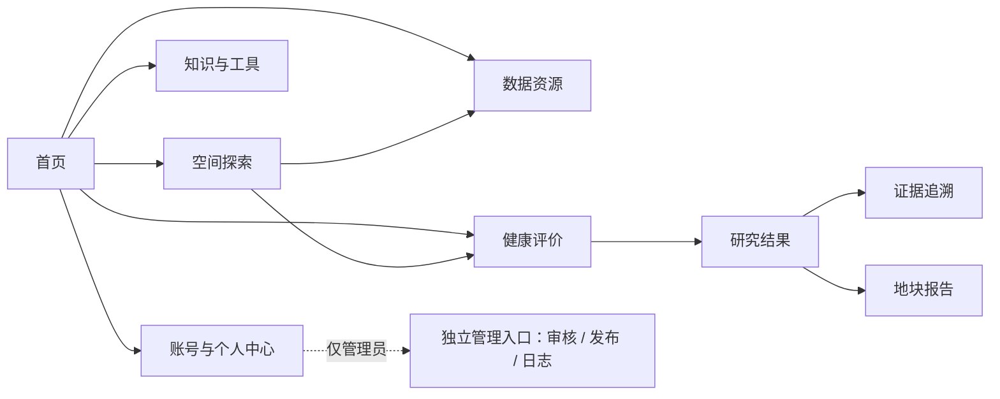

# Soilmate 全站 UI 参考库与设计蓝图

版本：1.0 · 2026-11-01 · 适用项目：壤脉天玑 / Soilmate

> 本文是设计与实现约定，不是功能上线声明。设计参考仅借鉴视觉组织和交互方法；科研结论必须回到本项目的数据、算法和证据。知识判断遵守项目 `AGENTS.md` 与 `01-现状评估与需求档案.md`。

> **2026-11-02 设计更新：**用户要求将健康评价、分析中心、证据追溯合并为同一健康研究工作区，并增加与研究任务关联的独立 AI 对话模块。相关导航、页面职责和 AI 交互以 [05-健康研究与AI助手一体化设计](05-健康研究与AI助手一体化设计.md) 为准；下文 5.4–5.6 节保留为旧方案与现状参考。

## 1. 产品判断

Soilmate 服务四种连续任务：**看空间格局 → 找数据与核对元数据 → 对自有样本做研究评估 → 追溯结论依据**。知识解释、历史任务和管理审核围绕这条链路展开。首页承担入口与品牌，地图承担空间探索，分析中心承担判断，数据资源中心承担可复查的数据说明。

全站不能套统一的“左侧菜单＋四张数字卡＋十张图”模板。不同页面有不同视觉主角：

| 页面 | 视觉主角 | 用户在 60 秒内应完成的判断 |
| --- | --- | --- |
| 首页 | 田野影像和一句明确价值说明 | 我该进入哪条工作路径？ |
| 空间探索 | 地图本身 | 当前看的是什么指标、什么分辨率、什么来源状态？ |
| 数据资源 | 指标目录与元数据 | 这份数据能否用于我的研究？ |
| 健康评价 | 样本、质量检查和受限结论 | 输入是否足够，评价是否适用？ |
| 分析中心 | 一个主要发现及其证据 | 现有数据支持什么，下一步做什么？ |
| 证据追溯 | 数据—处理—模型—结果链 | 结论从哪里来，哪一步尚未核实？ |
| 地块报告 | 地图、结论和依据的叙事 | 我可以分享或复核什么？ |
| 知识与工具 | 清楚的概念和引用 | 这个概念、公式或建议适用于什么条件？ |

## 2. 长期参考库

下表记录**借鉴的设计方法**，不是要迁移对方功能、数据或业务结构。相关页面为各产品的官方资料或产品入口；需要使用时先看实际页面，再核对当前版本。

| 参考 | 可借鉴 | 用在 Soilmate | 不照搬 |
| --- | --- | --- | --- |
| [Copernicus Browser](https://documentation.dataspace.copernicus.eu/Applications/Browser.html) | 图层选择与地图操作联动；空间画布优先 | 地图、图层抽屉、位置详情 | 遥感影像工作流和复杂卫星检索 |
| [NASA Worldview](https://worldview.earthdata.nasa.gov/) | 图层、透明度、时间和比较工具分层呈现 | 有真实多时相数据时再提供时间比较 | 没有多时相数据时放空时间轴。NASA 的[官方使用手册](https://earthdata.nasa.gov/s3fs-public/2025-03/worldview-booklet.pdf)说明其比较模式 |
| [Climate TRACE Explore](https://climatetrace.org/explore) | 从总览到类别、空间和具体对象的渐进展开 | 分析结果先总览，再维度、限制因子和证据 | 排放排行和 3D 球体；先保证土壤问题与统计方法匹配 |
| [SoilGrids](https://isric.org/explore/soilgrids/) | 属性、深度、单位、分辨率和预测不确定性分明 | 指标产品详情与元数据缺口 | 不把其栅格预测当本项目实测；官方当前提示其 REST API 暂停，不作生产依赖 |
| [Our World in Data](https://docs.owid.io/projects/etl/api/chart-api/) | 图、文字、数据下载和元数据相互可达 | 图表说明、证据追溯、报告脚注 | 与土壤无关的图型和数据叙事套路 |
| [Palantir Object Views](https://www.palantir.com/docs/foundry/ontology/applications) | 一个对象聚合属性、关系、分析和行动 | 样本、地块、数据集、评价任务的详情页 | 企业级复杂菜单、术语和权限模型 |
| [ArcGIS StoryMaps](https://doc.esri.com/en/arcgis-storymaps/latest/get-started/what-is-arcgis-storymaps.html) | 地图、文字和媒体构成有顺序的说明 | 区域报告、地块报告、知识案例 | 把交互工作台改成滚动故事 |
| [Mapbox Showcase](https://www.mapbox.com/showcase) | 底图、专题层、标注和信息板的视觉层次 | 地图样式与图例；不同指标的色带 | 未经检验的 3D/动画地图或其商业地图服务依赖 |

灵感库只用于找具体问题的页面案例：[Vercel Shipped](https://vercel.com/shipped) 看产品表达，[Mobbin](https://mobbin.com/browse/web/apps) 看完整流程，[SaaSUI](https://www.saasui.design/) 看表格与设置，[Awwwards](https://www.awwwards.com/) 和 [Godly](https://godly.website/) 看排版和动效。选例时要记录“解决了哪个交互问题”，不能只保存截图。

## 3. 全站信息架构



主导航用中文任务词：“首页、探索数据、数据资源、分析中心、证据追溯”。“Gold Dataset”可保留为内部数据产品系列名，不作为没有说明的主导航。健康评价从首页和地图进入；当任务系统成熟后再成为独立主导航。普通用户无后台入口。

## 4. 视觉系统

### 4.1 主题与令牌

保留现有田野大图融合版首页。大面积的内容界面为浅色；地图、数据资源、检测评估、分析中心和证据追溯的最外层统一用田野绿 `#28513B` 作画框，让浅色工作面浮在其上。绿色画框是界面背景，不是土壤数据图层。地图仍保持低饱和底图，让专题数据有最高对比；**不为了“深色地图”而压暗土壤色带**。未来若提供深色底图，应逐个核查图层、图例、地名与边界的可读性，并允许切换。

| 令牌 | 用途 | 当前建议 |
| --- | --- | --- |
| 页面底色 | 首页下方；各模块工作台外框 | `#F4F6F1`；工作台外框 `#28513B` |
| 纸面 | 卡片、表单、数据详情 | `#FFFFFF` / `#FBFCFA` |
| 主文字 | 标题与正文 | `#25372F` |
| 辅助文字 | 来源、说明、步骤状态 | `#4D6253` 左右；白色及浅绿底均须保持清楚对比 |
| 主绿色 | 主要操作和当前状态 | `#2E8057` |
| 深绿 | 首页照片遮罩、强调文字 | `#163B2C`，避免铺满工作区 |
| 边界线 | 数据分组 | `#DFE7DE` |
| 研究限制 | 待核验、不能计算 | 独立的暖灰/琥珀语义，不用“绿色=正确”概括 |

正文与控件优先“等线 → 苹方 → 微软雅黑”；主要标题用“Georgia + 华文宋体/宋体”形成编辑式层次。标题衬线只用于首页、页面标题和主要发现；表格、坐标、代码、单位继续用清楚的无衬线。数字启用等宽数字。说明文字至少约 13 px，步骤和字段辅助标签至少约 11–12 px；禁用操作保留可读文字，不靠整体降透明度表达状态。避免满屏英文大写标签和过小的 9–10 px 正文。

圆角按任务区分：输入框约 6–8 px、数据卡约 10–12 px、首页品牌卡约 16–24 px。地图页沿用封面的悬浮胶囊导航、绿色外框与圆角容器，点位剖面顶部以同一张田野影像作短幅引导；照片只占侧栏标题区，地图仍是主角。各模块浅色工作面加一层柔和投影，重要内容卡片再加更轻的投影，靠光影区分层级；不把每个表格单元都做成浮卡。交互反馈为 150–250 ms，遵守 `prefers-reduced-motion`。

### 4.2 共享组件

| 组件 | 必要内容 | 规则 |
| --- | --- | --- |
| 指标标识 | 名称、代码、单位、数据状态 | 单位不明写“待核对”；不以颜色代替状态文字 |
| 数据产品详情 | 来源文件、波段、分辨率、范围、缺失的元数据 | 未登记的年份、土层、实测/预测属性明确写出 |
| 地图图例 | 指标名、单位、色带范围、透明度 | 专题瓦片未发布时隐藏色带，直接说明当前只能查网格值 |
| 位置剖面 | 坐标、网格分辨率、有效值、来源状态 | 网格值不称“采样点实测值” |
| 发现卡 | 主要结论、支持证据、限制条件 | 一个发现一个主动作；无正式评分时不显示数字占位评分 |
| 证据链 | 输入数据、转换、模型版本、结果、来源 | 每一步有状态，能打开原始值或版本 |
| Agent 说明 | 输入事实、解释、引用、未解决问题 | 与算法输出视觉分离；不改写计算数值 |
| 空状态 | 当前为什么为空、下一步能做什么 | 不使用只写“暂无数据”的空白卡 |

## 5. 页面蓝图

### 5.1 首页：品牌与任务入口

首屏保留田野照片、浮动白色导航和“读懂土地，看见土壤的脉络”。一级操作进入地图，二级操作进入检测评估。首屏不摆未经核实的全国样本数、健康分或成果数字。下方采用一张较大的地图入口加数据、评价、知识的轻重不同入口；“知识与工具”未上线时保持“规划中”。

桌面阅读顺序：品牌 → 一句话 → 两个动作 → 工作路径。手机端先保证标题和按钮可读，再展示照片与辅助说明；页面本身可滚动，模块入口不能被固定高度裁掉。

### 5.2 探索数据：地图工作台

```text
导航：页面 / 数据状态 / 账号
┌工具轨┬──────────────────── 地图画布 ────────────────────┬位置剖面┐
│图层  │ 当前指标 · 分辨率 · 参考分区                       │坐标/类型│
│搜索  │ 专题层与底图、图例、透明度、可见数据状态           │六项指标 │
│定位  │ 点击网格或已审核采样点                             │来源/限制│
└──────┴─────────────────────────────────────────────────┴────────┘
```

桌面以地图为最大区域。封面导航进入地图时延续相同的品牌标识、浅色胶囊导航、田野照片短幅与标题字形，不让地图变成另一套后台皮肤。工具轨只保留图层、搜索和地图定位；数据资源走顶部导航，检测评估走首页入口，不在数据探索工具轨重复出现。图层目录按类别与搜索展开；点位详情只在选择后占据右侧。初次进入全国范围须正确居中。底图或专题瓦片未就绪时分别提示，并允许继续点选可用网格。位置详情的首层为坐标、类型和核心指标；扩展指标、区域背景和评价条件依次展开。没有经过核验的评分规则时，不显示健康等级。


多图层叠加、时轴和对比模式只有在数据的空间/时间一致性已核验后启用；否则保留单指标切换和透明度。避免假对比。

### 5.3 数据资源：目录优先，SQL 次级

第一屏为“查找指标 → 选择条目 → 看元数据 → 在地图查看”。左侧列表支持中文名、字段代码和来源文件搜索；右侧显示单位、空间分辨率、来源文件、波段、有效像元、数值范围，以及尚未登记的年份、土层和属性类型。现有原始表浏览保留在次级标签，供查字段与分页记录。

当正式数据集发布流程接入后，扩展为“数据集卡 → 版本/许可/质量 → 条件筛选 → 授权导出”。未接入下载权限与记录前，不放可点击但无后端的“导出 CSV”。

### 5.4 健康评价：先检查，再计算

目标顺序：地块与作物 → 输入/上传 → 单位和缺失检查 → 基线匹配 → 结果与报告。页面顶端应始终能看到当前数据、地区、作物和任务状态；错误定位到字段或表格行。基础分、N+X、微生物校正分区展示，不用一个数字覆盖全部判断。

现有 Soiledge 为研究/演示能力，原格式 Excel 与本批次标准化结果必须标明适用范围。缺少可核验基线或微生物配对与 QC 时，停在“探索性结果”并说明需要补什么数据。

### 5.5 分析中心：一个发现领路

内容区沿用地图工作台的品牌字形、田野绿与暖白纸面，但以浅绿等高线标题区替代地图页的田野照片短幅。项目选择、样本选择与主要发现按一条研究路径排列；白色卡片有轻阴影，行动栏用浅绿区分，不用满屏相同权重的卡片。标题、标签、控件与地图页保持同一文字层级。

顶部显示研究项目、样本、数据集和运行入口。结果页先给一个主要发现及结论等级，随后按“已有依据 → 限制/缺口 → 下一步研究行动”展开。图表只回答明确问题：分布、对比、稳定性或变化；每张图可见样本量、单位、处理方法与来源。原始值和技术参数用可展开详情承载。

当前研究工作台已有项目选择、样本、结果、配对审核和任务记录；未来图表/报告不能把独立微生物演示样本自动视为地图点位的样本级证据。

### 5.6 证据追溯、智能任务与报告

证据追溯以对象关系为核心：地块/样本 → 数据集版本 → 质量检查 → 算法版本 → 输出 → 人工审核。每个节点有时间、操作者/系统、输入摘要、状态和可打开的原始记录。智能任务页以“任务状态和所需操作”为主，不呈现聊天框式万能 Agent。报告页采用叙事顺序：对象与范围、主要发现、空间背景、证据、限制、管护建议与版本脚注。PDF 必须与网页使用同一份结果数据。

目前这些能力部分存在于研究记录和分析页；独立的证据关系图、完整地块报告、正式 PDF 仍属目标设计，不能写成已上线。

### 5.7 知识与工具、个人中心、管理后台

账号登录与注册页沿用田野绿外框，直接以田野照片的暗色裁切和带轻阴影的白色表单卡片构成主画面，不另设顶部导航条。返回首页入口放在表单卡片内。字段、错误、辅助说明和禁用状态保持可读；登录与注册共用同一布局，不把设计预览页当作真实身份流程。

知识文章统一包含：结论一句话、适用条件、概念/步骤、原始来源、审核时间、未核查部分。公式工具必须展示输入单位、换算式和适用边界。案例采用 StoryMaps 式“地图+文字+证据”顺序，但阅读页不承担地图工作台操作。

个人中心按“我的评价、下载记录、收藏、账号”组织，记录后端同步状态和版本；本地缓存只保留非敏感筛选偏好。后台单独路由，呈现审核队列、数据/模型版本和操作日志；权限在服务端验证，不靠隐藏入口。

## 6. 响应式与状态

| 宽度 | 地图 | 数据目录 | 分析/报告 |
| --- | --- | --- | --- |
| 宽桌面 | 工具轨＋大地图＋右剖面 | 列表＋元数据双栏 | 主发现＋辅助行动栏 |
| 平板 | 地图优先，剖面可收起 | 列表约 40%，详情约 60% | 单主栏，行动栏落到内容后 |
| 手机 | 地图全宽，图层抽屉/底部剖面 | 上方短列表，下方滚动详情 | 单栏，任务主动作贴近当前步骤 |

每个数据区至少有加载、空、错误、权限不足、部分可用五种状态。用户的筛选与输入在失败时保留。焦点可见，弹层关闭后返回触发处；地图上的视觉控件必须有文字或无障碍名称。

## 7. 当前落地与后续边界

| 区域 | 当前界面状态 | 仍需数据/后端支持 |
| --- | --- | --- |
| 首页 | 田野大图、任务入口；已修复下方内容的滚动 | 知识文章与真实产品案例 |
| 地图 | 图层抽屉、点位剖面、图例；已修复从首页进入时的中心偏移；瓦片未发布会提示 | 更多正式专题瓦片、多时相与可靠对比 |
| 数据资源 | 指标目录、真实接口元数据、原始表浏览 | 数据集版本/许可、授权导出和下载记录 |
| 健康评价 | Soiledge 研究输入与估算 | 经过验证的 N+X 基线、正式报告 |
| 分析/追溯 | 项目、样本、运行结果、配对审核、任务记录 | 更完整的证据关系和审核流 |
| 知识/个人/管理 | 产品设计已定义 | 页面与持久化功能逐步建设 |

验收时从用户任务出发：能否找到指标、理解单位和来源、看见不可用状态、返回地图、判断某一结论是否有足够证据。截图只能验视觉；正式评分、导出、权限和报告还需对应接口与数据的独立验收。
