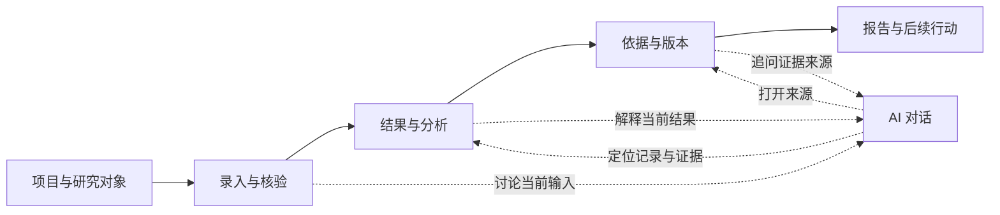

# 健康研究与 AI 助手一体化设计

> 设计状态：待评审；2026-11-02。本文定义目标体验，不代表功能已经上线。用户明确要求将健康评价、分析中心和证据追溯合成一条研究流程，并增加可与该流程关联的独立 AI 对话模块。本文取代《04-Soilmate全站UI参考库与设计蓝图》中 5.4–5.6 节的页面拆分方式；田野大图首页、地图和数据资源的现有视觉约定继续适用。

## 1. 产品决定

主导航改为：**首页｜探索数据｜数据资源｜健康研究｜AI 助手**。原“分析中心”“证据追溯”不再是独立主导航；它们成为健康研究中同一任务的“结果与分析”“依据与版本”。“健康评价”是任务入口，而不是只负责填表的一页。

用户一次选择项目、研究对象和任务，沿同一条流程工作：



**同一项任务，多个观察角度。**输入、结果、证据和对话都引用同一任务记录。AI 只解释或帮助查找，不能把自己的文字写成计算结果、实测值或审核结论。

## 2. 信息架构与页面职责

| 层级 | 用户看到的名称 | 负责回答的问题 | 现有能力去向 |
| --- | --- | --- | --- |
| 主导航 | 健康研究 | 我现在研究哪个对象、做到哪一步？ | `AssessmentWorkspace` 的录入；`ResearchWorkspace` 的项目与样本选择 |
| 工作区第一步 | 录入与核验 | 数据来自哪里，单位、身份、时间、土层是否成立？ | 快速录入、地块资料、CSV 导入、样本配对审核 |
| 工作区第二步 | 结果与分析 | 当前数据实际支持什么判断？ | 研究结果、主要发现、限制和下一步行动 |
| 工作区第三步 | 依据与版本 | 结论可追溯到哪些输入、处理和算法？ | 运行记录、数据集版本、来源哈希、审核状态 |
| 工作区第四步 | 报告与记录 | 哪个版本可分享，后续需做什么？ | 报告版本、行动记录、下载入口 |
| 主导航 | AI 助手 | 我想围绕当前任务继续讨论，或发起独立研究问答 | 新的完整会话工作区 |

研究项目下可有多项任务；一项任务绑定一个明确的研究对象及其数据范围。对象可为地块、土壤样本或微生物样本。地图网格位置只可作为**参考位置**，不能自动等同于实测样本；土壤和微生物样本只有通过身份、时间、土层与来源审核后才能建立联合关系。

### 健康研究首页

进入后先显示“继续上次任务”和任务列表。任务行只显示对象、数据类型、当前阶段、证据状态和最后更新时间。新建任务时选择“已有检测数据”“研究数据集”或“从地图参考位置开始”；三种入口最终进入同一工作区，不产生三套结果页。

### 同一任务的工作区

顶部固定显示对象名称、项目、样本/地块 ID、当前任务版本和状态。其下为四个阶段。阶段可直接回看；尚未完成的阶段显示原因与下一步，不填充空白分数。结果页以一个主要发现为焦点，接着是“支持依据 → 限制/缺口 → 建议下一步”。点击任何结论的“查看依据”直接定位到对应证据节点。

微生物功能分析和土壤健康审计可共用任务框架，但各自保留算法与证据类型。只有经过配对审核，才出现“联合解释”；否则分别展示，避免把独立案例拼成一个地块结论。

## 3. 两处 AI，对应同一会话能力

### 健康研究内：任务 AI

桌面在主内容右侧使用可收起的讨论栏，手机使用独立抽屉。讨论栏随任务保持同一个会话，阶段切换时不清空聊天记录。标题写“讨论这次研究”，并显示当前绑定的对象与结果版本。

- **录入与核验阶段**：解释字段、单位和缺失条件；指出还需用户提供什么。此时不能说“评价结果表明……”。
- **结果与分析阶段**：解释已经生成的结果、适用范围和限制。每个关键判断链接到结果字段或证据节点。
- **依据与版本阶段**：回答“这个结论来自哪里”“哪个步骤未核查”“换了数据版本会怎样”，并提供打开原始记录的入口。
- **报告阶段**：帮助组织说明文字或问题清单；正式报告仍由版本化结果生成并经用户确认。

在讨论栏点击“进入 AI 助手深入讨论”时，打开同一会话的完整页面，保留消息、任务绑定和来源链接。返回任务时回到原阶段和滚动位置，不复制一份平行聊天。

### 独立模块：AI 助手

独立页面的左侧为会话列表，中间为对话，右侧为“关联的研究对象 / 本轮依据”。默认可以发起不绑定任务的概念性问答；此时明确写“未关联研究记录”，不得声称看过用户的评价。用户可以主动选择项目、样本或某次结果版本来关联。任务内打开的会话优先显示当前任务卡；解除关联后，既有消息保留，但后续回答不再读取该任务。

登录后才能读取研究任务并保存会话历史。未登录时仍可看到 AI 助手入口和能力说明，开始对话或选择任务前进入现有登录流程；登录返回后恢复原目标。

**上下文切换规则**：从任务 A 切到任务 B 时，不悄悄替换会话背景。界面提供“为 B 新建会话”或“在当前会话中追加 B 并明确比较范围”两个动作。默认选新建，避免混淆两块地、两次采样或不同算法版本。

## 4. 上下文契约：让 AI 知道什么，也知道不知道什么

AI 接收的上下文由服务端从已授权记录组装；前端只传任务与结果 ID，不把页面文字拼成不可追溯的提示词。一次会话绑定一份**不可变的上下文快照**：

| 字段 | 内容 |
| --- | --- |
| 研究对象 | 项目、对象类型、样本/地块 ID；地图参考位置单独标识 |
| 输入 | 指标代码、数值、单位、检测/导入来源、采样日期、土层、缺失项 |
| 结果 | 运行 ID、结果状态、算法与参数版本、已计算值、禁止推断的结论 |
| 证据 | 数据集版本、质控、转换步骤、来源 URI/哈希、人工审核状态 |
| 范围 | 权限、适用区域、作物、可比较对象及已知限制 |
| 时间 | 快照创建时间与当前结果是否已有更新版本 |

对话顶部显示“已关联：样本 X · 运行版本 Y · 探索性结果”等可读摘要，提供“查看所用上下文”和“关联最新版本”。如果任务之后重新计算，旧会话继续引用旧快照，并提示已有新版本；用户确认后才开启新版本讨论。

AI 回复采用固定的信息层次：**直接回答 → 依据链接 → 不确定或缺失 → 可执行的下一步**。依据链接指向任务内的原始字段、运行步骤或知识笔记。知识笔记进入回答时，应携带原始来源、适用条件和未核查部分。页面草稿、预测地图值和合成示例必须保留各自身份，不能被写成实测证据。

## 5. 页面布局草图

### 桌面：健康研究

```text
┌ 顶部：项目 / 对象 / 任务版本 / 当前状态 ───────────────────────────────┐
│ 录入与核验 ── 结果与分析 ── 依据与版本 ── 报告与记录              │
├──────────────────────────────────────────────┬───────────────────┤
│ 当前阶段的唯一主内容                          │ 讨论这次研究      │
│ 一条主要发现或一项正在完成的输入任务           │ 关联对象与版本    │
│ 依据 → 限制 → 下一步                           │ 消息与来源链接    │
│ 点击依据直接定位到对应记录                     │ 输入 / 深入讨论   │
└──────────────────────────────────────────────┴───────────────────┘
```

AI 栏占约 28% 的内容宽度，默认可收起；主内容保留足够阅读宽度。不要把录入表、结果卡、证据链和聊天框压成四个等宽列。手机按“对象与状态 → 阶段 → 主内容 → AI 抽屉”排列；对话在单独视图中阅读，避免小屏多层嵌套滚动。

### 桌面：独立 AI 助手

```text
┌ 会话列表 ┬──────────────────── 当前对话 ───────────────────┬ 上下文与依据 ┐
│ 新建对话 │ 关联卡：项目 / 样本 / 结果版本 / 证据状态       │ 使用的记录   │
│ 历史会话 │ 用户问题、回答、可点开的引用                   │ 缺失的条件   │
│          │ 底部固定输入框                                │ 更新版本入口 │
└──────────┴─────────────────────────────────────────────────┴──────────────┘
```

手机只保留当前对话；会话列表和上下文分别从按钮打开。输入框保持可见，长引用折叠但可打开。视觉上沿用田野绿外框、暖白纸面和宋体标题；结果与 AI 回答用不同的排版容器，避免把生成文字误看成正式评价。

## 6. 状态与边界

| 状态 | 健康研究显示 | AI 显示 |
| --- | --- | --- |
| 仅有录入草稿 | “尚未提交分析”及已填/缺失字段 | 只讨论录入与单位，不生成健康等级 |
| 数据不足或规则未核验 | 可用结果与阻断原因分别列出 | 解释缺口，不补造评分 |
| 探索性结果 | 明确标“探索性”，附算法与数据版本 | 回答附相同状态及依据链接 |
| 经审核结果 | 显示审核人、时间和适用范围 | 可解释结论，但不能替代审核 |
| AI 服务不可用 | 录入、结果、证据、报告照常可用 | 明示本机/服务状态，保留未发送文本 |
| 无权限访问关联记录 | 不显示内容 | 不注入该记录；提示重新选择有权限对象 |

需要真实计算或审核的动作仍由确定性服务和授权用户完成。AI 初期只可调用只读工具：读取本人的任务、结果、证据和有来源的知识；写入报告、修改数据、批准样本配对等动作另设明确确认与审计。现有本机 Ollama 可以作为可选模型提供者，但当前 `/api/soiledge/ai` 的单轮说明接口不等于完整会话服务。

## 7. 落地顺序与验收

1. **统一导航和任务对象**：健康评价、研究结果、追溯记录使用共同的任务 ID；`/analysis`、`/evidence` 和既有 `/assessment` 链接跳到对应阶段，保留已有记录及草稿。
2. **合并工作区**：迁入录入、项目/样本选择、结果、配对审核、证据和报告；移除重复标题与重复对象选择。没有实际结果时，结果阶段显示明确空状态。
3. **接入双入口 AI**：同一会话服务支持任务侧栏和独立页面；先实现只读上下文、引用和版本快照，再开放更复杂的工具。
4. **评价服务接入后扩展**：结果、算法版本和人工审核回写统一任务记录；AI 读取新版本须经用户确认。

验收时从同一土壤样本完成一次输入，能不重新选样本地查看结果、打开对应证据、在侧栏追问、转到完整 AI 页面并返回原任务。对未完成分析、独立微生物样本、不同数据版本和模型离线状态分别检查，不得出现虚构评分或跨样本混用。

## 8. 依据、适用范围与未核查部分

**原始来源**：用户在本次讨论中的明确产品要求；现有 `frontend/src/assessment/AssessmentWorkspace.vue`、`frontend/src/ResearchWorkspace.vue`、`frontend/src/App.vue`、`backend/app/api/soiledge.py`；《04-Soilmate全站UI参考库与设计蓝图》；土壤健康知识库入口 `E:\SoilHUB\土壤健康知识库\从这里开始.md`。Agent 的工具与边界术语参考 [OpenAI Agent 实践指南](https://openai.com/business/guides-and-resources/a-practical-guide-to-building-ai-agents/)，具体页面与对象设计为本项目推导。

**适用条件**：适用于 Soilmate 网站的目标信息架构与后续开发评审。本文不把当前前端录入确认、地图栅格、合成示例或微生物公开案例当作正式土壤健康评价。

**尚未核查**：正式评价算法与阈值、生产 AI 模型及部署方式、会话留存策略、项目权限粒度、样本与地块的持久化关系、完整证据 API、PDF 发布流程。实施前须逐项确认；对应功能在确认前保留明确的未接入状态。
